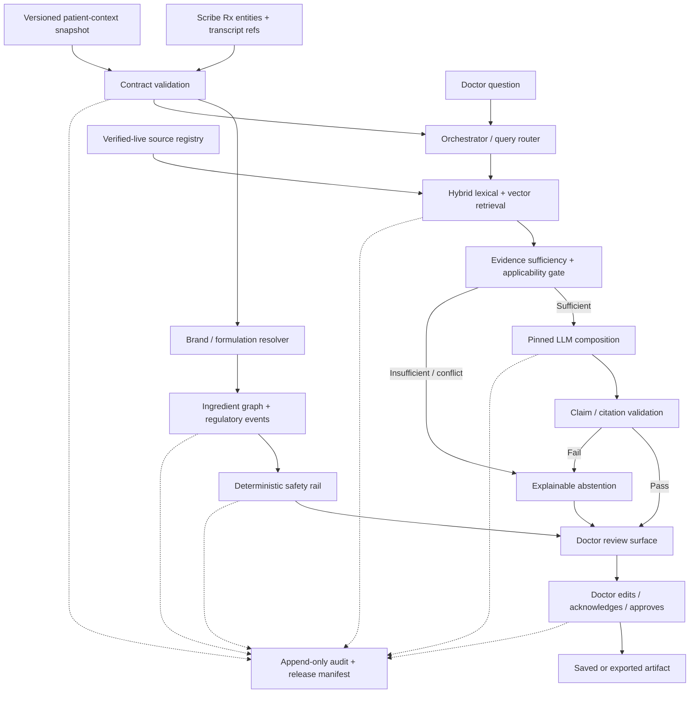

# BRAHMO Clinical AI — Final Architecture and Doctor-Readiness Plan.

**Candidate:** Naresh Nagaraj  
**Assessment opening:** 16 October 2026, 12:58 IST  
**Submission:** 16 October 2026, 13:08 IST  
**Basis:** BRAHMO Architecture Assessment — Merged Candidate Pack v1.0 and official sources linked below.  
**Status:** Proposed end state. No clinical, legal, licensing, regulatory or production approval is represented as complete.

## S1 · Final Architecture

BRAHMO should be a doctor-facing clinical-reference and medication-review layer, not a general medical chatbot. Use a modular application with separate clinical-evidence and deterministic drug-safety paths, sharing identity, context contracts, authorization, audit and release controls. Keep safety modules independently testable; avoid many separately operated services until scale requires them.

### Components and trust boundaries

| Component | Responsibility / boundary |
|---|---|
| Scribe adapter | Validates versioned Rx entities, preserves original text/source spans and confidence, and quarantines malformed or unsupported schemas. Confidence helps prioritize review; it is not proof. |
| Patient-context adapter | Accepts immutable, time-stamped snapshots with per-field provenance and `KNOWN`, `UNKNOWN` or `CONFLICT` state. Missing fields are never negative findings. |
| Drug identity graph | Canonical product/brand/variant, ingredient/salt, strength, form, route, FDC components, alias evidence and effective-dated regulatory events. Fuzzy search proposes candidates only. Inventory is separate and never establishes legality. |
| Knowledge service | Immutable source editions and decision-unit chunks with permission status, citations, population/specialty scope, effective dates, conflicts and supersession. Only `verified-live` material can support consequential answers. |
| Retriever and sufficiency gate | Sparse lexical plus dense vector retrieval, scope/rights/validity filters, conflict handling and deterministic sufficiency checks. Similarity does not prove applicability. |
| LLM gateway | Single contracted provider/model version, private approved India-region endpoint, no-training/retention terms, PHI minimisation and pinned parameters. It composes only from passed evidence and never calls the safety rail. |
| Safety rail | Pure, versioned lookup/rule execution over verified product identity, approved rule content and context. No LLM, embedding or network call in the check path. |
| Doctor surface/export | Shows citations, versions, context freshness, uncertainty, conflicts and all check states. Requires explicit doctor review/approval; cannot autonomously amend, sign or transmit a prescription. |
| Audit/release control | Append-only events record actors, tenant, inputs/outputs, context and source IDs, drug mappings, rule/model/prompt/index versions, doctor decisions and export hash. Changes require a release manifest and regression. |

**Trust boundaries:** device-to-app; Scribe/context integrations; ingestion-to-serving corpus; app-to-model provider; tenant-to-shared services; and BRAHMO draft-to-clinician/EMR. Use server-side tenant authorization, short-lived sessions, least privilege, encryption, secrets management and service identity. A tenant ID supplied by the client is not authorization.

### Entities and contracts

Core entities: `Tenant`, `UserRole`, `EncounterRef`, `PatientContextSnapshot`, `ScribeRxDraft`, `RxEntity`, `BrandProduct`, `Ingredient`, `FDCComponent`, `Alias`, `MappingEvidence`, `RegulatoryEvent`, `RulePack`, `CheckRun/Result`, `KnowledgeSource/SourceVersion`, `DecisionChunk`, `ClinicalQuestion`, `AnswerClaim/Citation`, `CorrectionCase`, `DoctorDecision`, `ExportArtifact`, `ReleaseManifest` and `AuditEvent`. Canonical facts and tenant overlays are separate.

**Scribe contract:** versioned envelope with tenant/encounter/draft IDs, timestamp, locale and Rx entities. Each entity preserves raw brand text/script, strength/unit, formulation, route if captured, instructions as recorded, transcript span, extraction method/confidence and unknown fields. Adapter returns accepted/quarantined/rejected plus reason and idempotency key. Unsupported schema versions fail visibly.

**Patient-context contract:** immutable snapshot ID/version, tenant/encounter/pseudonymous patient reference, timestamp, source system, consent/purpose reference and fields such as age band, pregnancy/lactation, allergies, active medicines and relevant conditions. Each field has state, source, observed/recorded time and revision. Conflicts remain visible; field-specific freshness limits apply. Send no direct identifiers to the model by default.

Structured-first is retained: drug identity, ingredients/FDCs, price and regulatory-state facts are served from versioned structured stores, not generated text or vector retrieval. Affordability/alternative questions may show only source-backed product/price comparisons; they never infer live stock or generate a treatment substitution. Authenticated, versioned interfaces cover `rx-drafts`, `context-snapshots`, `clinical-questions`, `medication-reviews`, `corrections`, `doctor-decisions` and `export-artifacts`. Every write is authorized, schema-checked and idempotent. The receiving EMR performs its own authorized finalization.

### Doctor paths

**Clinical reference:** doctor types/dictates in a supported language; normalization preserves original wording. Router classifies the requested claim type. Retrieval filters current, licensed, applicable sources. A deterministic gate checks evidence sufficiency and conflicts. The pinned LLM drafts only supported claims; server-side validation binds each consequential claim to an exact source version/location. Doctor reviews answer, source, population caveat and uncertainty, then accepts/edits/rejects. Unsupported requests receive a reasoned abstention.

**Medication review:** validate prescription and context; resolve brand, strength and formulation; decompose FDCs; run the deterministic rail only on verified identities and approved rules. Ambiguity blocks affected checks. Doctor sees findings, matched products/ingredients, rule/source versions and coverage, then edits or acknowledges. No individualized dose is calculated and no prescription is silently changed.

**Fictional reference demonstration only:** “For Scenario Condition Q in Population A, Demo Source S-104 v2 §4.1 p.12 supports claim C1 only.” Source and claim are synthetic; no clinical recommendation is asserted.

**Fictional medication demonstration only:** if “Brand Z 10” maps to two formulations, return `UNVERIFIED_INPUT — formulation ambiguous; dependent checks not run`, show candidates and request confirmation. Never infer identity from stock or display “safe.”

## S2 · Decision Register

| ID / area | Current position or omission → decision; rationale and rejected alternative | Accepted cost / validation |
|---|---|---|
| D01 Grounding | Use domain-scoped source authority: official legal events for regulatory claims; ICMR/programme sources within scope; validated specialty sources for their remit; international sources as labelled background. Tenant protocols cannot override law or safety. A universal ladder ignores scope; tenant-first truth is unsafe. | More conflicts/abstentions. Counsel and clinicians review precedence; test supersession, concurrent conflict and tenant visibility. |
| D02 Chunking | Structural decision-unit chunks preserve heading, population, units, tables, footnotes, exceptions and cross-links. Fixed token chunks can separate a recommendation from its caveat; whole-document retrieval is noisy. | More parsing/review. Inspect source-to-chunk fidelity; 100% review of safety/legal content. |
| D03 Retrieval | Hybrid lexical + vector retrieval, with rights/scope/currentness filters before ranking, then a separate sufficiency gate. Vector-only misses exact product/legal strings; lexical-only misses paraphrase and mixed-language queries; LLM-only sufficiency is not deterministic. | Higher latency/complexity. Gold-passage retrieval and applicability tests by language and question class. |
| D04 Index | Postgres for canonical metadata/events; encrypted India-region object store for immutable sources/audit; India-region search index for lexical and dense retrieval. Initial embedding/sparse-retrieval candidate: self-host [BAAI/bge-m3](https://huggingface.co/BAAI/bge-m3/tree/d5ab3da48ec596cd78a50b27e52c7211b49d870f), MIT-licensed per its model card, pinned to that immutable repository revision and artifact hashes. Its multilingual capability is a starting point, not proof of quality for Indian clinical language pairs. Use lexical/BM25 + dense/sparse retrieval; add a cross-encoder reranker only if independently validated. Reject a single opaque vendor index because it weakens rollback, rights-aware withdrawal and replay. | Index/model operational burden and extra latency. Snapshot/rebuild, withdrawal, freshness and language-stratified retrieval regression tests; legal/security review of model artefacts and clinical-query suitability gate before serving. |
| D05 Drug data | Keep ingredient graph and events; do not claim a complete free Indian brand master exists. Combine licensed product data, official records and a qualified-reviewer-approved critical set; local aliases only propose candidates. Inventory/fuzzy matching cannot establish truth. | Limited initial coverage. Independent held-out key, variant/FDC collisions and zero silent wrong mappings. |
| D06 Safety | Pure deterministic rules only; no model call. Detect duplicate ingredients but do not total personalized doses or compare calculated exposure to a personalized threshold because the fixed fence excludes patient-specific dose calculation. | More clinician review. Prove no model/network dependency; test all eight states and have a pharmacologist sign off every serving rail rule. |
| D07 Provider | Single pinned LLM behind gateway, only with written no-training, retention, subprocessor, incident and India-region terms. Reject automatic failover to another provider because it silently changes privacy and behavior. If acceptable terms are absent, do not send patient context; abstain or use approved retrieval-only output. | Vendor dependency and visible outage. Contract, region, egress and model-change tests. |
| D08 Residency | Keep primary clinical data, audit and required operational logs in India; allow provider processing only in approved India region under contract. Reject a global-region default for convenience because it increases transfer and log risk. Treat location as policy and verify actual legal restrictions rather than claiming blanket statutory localisation. | Procurement constraint. Map data/backup/subprocessors; verify CERT-In scope and contract region. |
| D09 Tenancy | Shared app with strict server-side tenant authorization, tenant keys or equivalent envelope protection, tenant filters and negative tests on every API/search/cache/export/log. Global corpus read-only; tenant overlays isolated. Full per-clinic stacks are costly; row filters alone are fragile. | Shared infra blast radius. Cross-tenant adversarial tests and independent security review. |
| D10 Audit | Append-only events and release manifests; store exact output bytes plus complete source/rule/model/prompt/index/input trace. Separate historical byte-exact reconstruction from nondeterministic model re-execution. Recompute-only replay cannot ensure historical bytes. | PHI retention/storage complexity. Golden-thread archive replay, hash check and access/retention tests. |
| D11 Source rights | Permission manifests distinguish access, extraction, storage, indexing/embedding, excerpt display, derivatives, audit, updates, geography and training. Public download is not blanket commercial reuse. | Slower corpus growth. Legal owner signs each rights matrix; ingestion blocks missing/expired permission; withdrawal drill. |
| D12 Population/language | Population, pregnancy/lactation, form, specialty, jurisdiction and language are explicit scope dimensions. Translate carefully but preserve source-language evidence. Validate English, Hindi, Tamil, Telugu and Kannada independently instead of assuming national readiness. | Abstentions and evaluation effort. Per-stratum gold cases; critical translation-error gate; coverage matrix. |
| D13 Offline/degraded | Signed, encrypted read-only approved references may be cached with date/version; disable live medication review if data/service freshness is unproven. No fallback that looks normal. Full offline decision support is riskier to keep current. | Some work stops during outage. Outage, expiry, cache tampering and shared-device tests. |
| D14 Regulatory classification | Resolve intended purpose and Medical Devices Rules/MDSW pathway with qualified counsel before enabling clinical functions; reject a disclaimer-only or 'launch first, classify later' posture because it may miss required authorization. | May block release pending determination. Dated classification memo, applicable route/approval and version-specific release gate. |

## S3 · Grounding & Sources Plan

### Source strategy, scope and rights

| Source | Purpose / limitations | Rights and serving consequence |
|---|---|---|
| [ICMR Standard Treatment Workflows](https://www.icmr.gov.in/standard-treatment-workflows-stws) and [downloadable books](https://www.icmr.gov.in/downloadable-books) | Indian clinical guidance within the exact condition/population/edition covered. ICMR lists STW Vol I (2019), Vol II (2022 special paediatric/extrapulmonary TB) and Vol III (2022); this is not complete coverage of every condition or later update. | Public hosting does not settle commercial indexing/display rights. Obtain written permission or legal determination before extraction, embeddings, excerpts or production use. |
| [MoHFW](https://www.mohfw.gov.in/), [Clinical Establishments Standard Treatment Guidelines](https://www.clinicalestablishments.mohfw.gov.in/en/standard-treatment-guidelines), [NTEP guidance](https://tbcindia.mohfw.gov.in/guidelines/) and [NCVBDC guidance](https://ncvbdc.mohfw.gov.in/index1.php?level=1&lid=3686&sublinkid=5899&theme=Blue) | Primary for the programme-specific scope, not a universal precedence rule. Track the exact circular/PDF and supersession. Rights are item-specific: an NTEP Knowledge Base entry for ‘Guidelines and Norms for STDCs’ identifies CC BY-NC-SA 3.0 IGO, a non-commercial licence not to be assumed sufficient for commercial use ([entry](https://ntep.in/node/2567/BookPage/guidelines-and-norms-stdcs-ntep)). | Check rights per document and operation. If unclear, link for manual access but keep it out of production generation. |
| [CDSCO approved new drugs](https://www.cdsco.gov.in/opencms/opencms/en/Approval_new/Approved-New-Drugs/), [CDSCO Acts and Rules](https://www.cdsco.gov.in/opencms/opencms/en/Acts-and-rules/) and official notifications | Regulatory evidence, schedules, approval/alert/notification records. Approved-new-drug lists are not a comprehensive current marketed-brand/pack master; a missing record does not prove approval or prohibition. | Preserve notification IDs/effective dates, check extraction rights and later orders/stays. Legal review required before a record creates a serving regulatory result. |
| [CDSCO Medical Device Software guidance](https://www.cdsco.gov.in/opencms/export/sites/CDSCO_WEB/Pdf-documents/Guidance-document-on-Medical-Device-Software-under-MDR-2017.pdf), 21 July 2026 | Current official awareness guidance under MDR-2017; it states it is not legal/professional advice. Actual classification depends on intended purpose and functions. | Counsel must approve a dated classification memo and any applicable pathway before release. |
| [NPPA DPCO 2013 and amendments](https://nppa.gov.in/en/drugspricescontrolorder2013), [NPPA DPCO page](https://nppa.gov.in/en/dpco2013), [PMBI product/MRP list](https://www.pmbi.co.in/ProductList.aspx) and NLEM | Official price-control orders and price-related evidence. NPPA lists a DPCO amendment dated 30 June 2026; NLEM 2022 is not stock data or an exhaustive clinical formulary. | Check current pack/strength/effective date and commercial extraction rights. Never infer clinical suitability or stock from a price record. |
| [CDSCO adverse-drug-reaction notices](https://www.cdsco.gov.in/opencms/opencms/en/Notifications/Adverse-Drug-Reaction-related-Notifications/) / PvPI material | Dated safety notices/signals for the named drug/event, not a complete interaction database or individualized risk estimate. The CDSCO page listed notices dated September 2026 when reviewed. | Preserve exact source and scope; clinical reviewer decides how any notice becomes a rule. |
| Licensed Indian product/ingredient/interaction compendium and lawful prescribing information | Brand/variant/salt/strength/FDC mapping and needed safety content. No exhaustive regulator-maintained openly reusable Indian brand/strength/form catalogue was identified in this review. | Contract must permit commercial CDS, extraction, database storage, indexing, excerpt display, audit/retention, updates and derived mappings. Until then, serve only the independently reviewed critical set. |
| [Drugs Rules, 1945 (India Code PDF)](https://www.indiacode.nic.in/bitstream/123456789/19158/1/2016drugsandcosmeticsact1940rules1945.pdf), [NDPS Act, 1985 (India Code)](https://www.indiacode.nic.in/indiacode/handle/123456789/1791?col=123456789%2F1362&view_type=search), NDPS Rules and current Gazette notices | Legal basis for relevant schedules and restrictions, including H/H1/X where applicable. Consolidated PDFs can lag amendments or court orders. | Counsel verifies current text/orders. No unverified extraction becomes a “banned” claim. |
| [Telemedicine Practice Guidelines, 25 March 2020](https://esanjeevani.mohfw.gov.in/assets/guidelines/Telemedicine_Practice_Guidelines.pdf); [NMC regulations index](https://www.nmc.org.in/rules-regulations-nmc/1000/) | Professional-workflow context if an RMP uses BRAHMO in telemedicine; NMC’s index lists the 2023 conduct rules and the August 2023 abeyance notice. Recheck for later Gazette updates. | Counsel confirms applicability; BRAHMO does not author/sign prescriptions or replace RMP duties. |
| [WHO guideline portal](https://www.who.int/publications/guidelines) and tenant protocols | International sources as labelled background only; tenant protocols are tenant-scoped local context. Neither may override Indian law/canonical drug truth. | Check terms per source and contract per tenant. Protocols require owner, scope, approval, expiry and revocation; no unlicensed reproduction. |

### Lifecycle, chunking and validation

1. **Register rights and provenance:** publisher, exact edition/date, URL, retrieval timestamp, checksum, scope, effective/expiry dates, owner and permissions for extraction, storage, indexing/embeddings, display, derivatives, audit, updates and training. Default training permission is none; missing permission blocks production.
2. **Acquire immutably and structure:** retain original files and hashes; parse headings, table headers/rows, units, footnotes, exceptions, negation, page/section IDs and cross-references. OCR or low-confidence extraction is quarantined for review.
3. **Review and compare:** verify against original rendered pages, especially numbers, units, negation, population, formulation and table columns. Safety-rail data and legally consequential events require 100% qualified human review. Cross-check sibling rows/references to catch a poisoned “canonical” record.
4. **Chunk by decision unit:** one recommendation/table row/exception plus its heading path, scope, units, necessary footnotes and related cross-page/table context. Do not use fixed token windows that sever conditions or exceptions.
5. **Index and retrieve:** generate vectors with [BAAI/bge-m3 at pinned revision `d5ab3da48ec596cd78a50b27e52c7211b49d870f`](https://huggingface.co/BAAI/bge-m3/tree/d5ab3da48ec596cd78a50b27e52c7211b49d870f) under the deployment boundary; store model/revision, tokenizer/config hashes, dimensions and normalization in the release manifest. Use lexical + dense/sparse retrieval, with rights, validity and scope filters applied before ranking. Model-card language coverage is not evidence of clinical precision in English–Tamil, Hindi, Telugu, Kannada or code-switched cases; only validated language strata can serve. A cross-encoder reranker is optional and must pass the same held-out tests before adoption.  
6. **Publish/version/withdraw:** only `verified-live` items serve. Superseded editions remain in history but stop serving current answers. Concurrent valid disagreement is shown as conflict, never blended. Source update, expiry, rights loss, correction, stay or reversal creates a review/withdrawal event and regression.

**Compact synthetic chunk example:** `SRC-DEMO / v2 / §4.1 / p.12 / Population A / units preserved / footnote linked / verified-live / rights=approved`. It is illustrative only. Applicability and citation support are separate from retrieval relevance: gold-passage tests measure retrieval; scope-labelled cases test applicability; human review checks each consequential claim against its exact source location. The generator cannot invent citation IDs; server-side validation binds claims to registered sources. An international fallback or tenant overlay cannot silently supply Indian legal status.

## S4 · Rules of Behavior for India

Primary sources reviewed on 16 October 2026 inform these product controls; this is not a legal opinion. Distinguish law, regulator guidance, contract and BRAHMO policy. Qualified Indian privacy/regulatory counsel must check the exact launch configuration and later changes.

| Condition | Required / prohibited behavior | Basis and enforcement / required approval |
|---|---|---|
| Consequential clinical question | Answer only from applicable, permission-cleared, versioned evidence with claim-level location; otherwise abstain and name the gap. General model knowledge is not evidence. | BRAHMO fixed boundary; deterministic sufficiency/citation gate. Clinical lead approves intended use. |
| Ambiguous brand/formulation, stale mapping or conflicting drug record | Do not auto-resolve or run affected checks. Show candidates/reason and `UNVERIFIED_INPUT`, `SOURCE_CONFLICT` or `PARTIAL_COVERAGE`. | CDSCO approved-new-drug data is not a complete brand master. Zero silent wrong mappings is a release gate. |
| Missing rule/input or unavailable dependency | Preserve one mandated check state; never render missing, expired or failed checks as safe. | Fixed eight-state contract; UI/API conformance tests are release blockers. |
| Regulatory/banned/restricted status | Use effective-dated official events with notification, scope, source, effective dates, supersession and stays/reversals. Stock does not prove legality; price control is not market approval. | Drugs and Cosmetics Act/Rules, CDSCO/Gazette and NPPA DPCO. Counsel reviews enabled legal-state catalogue. |
| Patient context is missing/stale/conflicting | Ask for confirmation or show unknown; absence never means no allergy, no pregnancy or no concomitant medicine. | Safety policy and applicable privacy/security requirements. Contract/TTL tests; clinician approves context needed by each rule. |
| Software medical-purpose classification | Do not assume disclaimer or clinician oversight alone avoids device obligations. Resolve intended purpose, classification and any approval/licence route before enabling affected capability. | CDSCO says devices are regulated under the Drugs and Cosmetics Act, 1940 and Medical Devices Rules, 2017; its Medical Device Software guidance (Doc No. CDSCO/MD/GD/MDSW/01/2026, 21 July 2026) states it is awareness guidance, not legal advice. [Official page](https://www.cdsco.gov.in/opencms/opencms/en/Medical-Device-Diagnostics/Medical-Device-Diagnostics/) · [guidance](https://www.cdsco.gov.in/opencms/export/sites/CDSCO_WEB/Pdf-documents/Guidance-document-on-Medical-Device-Software-under-MDR-2017.pdf). Counsel’s dated classification memo is a blocker. |
| Patient data, privacy and model processing | Minimise patient data; document purpose/notice/consent or other lawful basis, minors/guardian handling, access, retention/erasure and processor controls; no training or unapproved-region PHI transfer. | DPDP Act 2023 and Rules 2025 are phased. Under G.S.R. 843(E) (dated 13 Nov 2025), sections 1(2), 2, 18–26, 35, 38–43 and 44(1),(3) commenced on publication; section 6(9) and section 27(1)(d) are on the one-year track; sections 3–5, 6(1)–(8),(10), 7–17, 27 except 27(1)(d), 28–34, 36, 37 and 44(2) are on the 18-month track. Rules G.S.R. 846(E) are phased too: Rules 1, 2 and 17–21 on publication; Rule 4 after one year; Rules 3, 5–16, 22 and 23 after 18 months. As at 16 Oct 2026, core duties were scheduled for May 2027 and nearer-term provisions around November 2026; confirm exact dates against Gazette publication metadata and later corrigenda. [Act notice](https://egazette.gov.in/WriteReadData/2025/267647.pdf) · [MeitY rules index](https://www.meity.gov.in/documents/act-and-policies/digital-personal-data-protection-rules-2025-gDOxUjMtQWa). Counsel must also assess transition from the IT Act/SPDI Rules 2011, which cover medical information: [official rules text](https://upload.indiacode.nic.in/showfile?actid=AC_CEN_45_76_00001_200021_1517807324077&filename=GSR313E_10511%281%29_0.pdf&type=rule). Apply safeguards now; phased commencement is not a reason to postpone privacy controls. |
| Cloud location / cyber incident | India-region residency is BRAHMO policy; keep mandated ICT logs securely in India and maintain incident reporting/contact process. Avoid default duplication of full clinical prompts in operational logs. | CERT-In Directions under IT Act §70B (28 Apr 2022) require reporting specified incidents within six hours and ICT logs for 180 days in Indian jurisdiction. [Directions/FAQ](https://www.cert-in.org.in/Directions70B.jsp). This does not assert a blanket health-data localization rule. Counsel verifies current scope and any amendments. |
| Prescription, signature or telemedicine | Current scope is reference/review; do not author, sign, transmit or finalize prescriptions or provide patient-facing advice. Export stays draft until authorized clinician/EMR finalizes it. | Telemedicine Practice Guidelines (25 Mar 2020): [official PDF](https://esanjeevani.mohfw.gov.in/assets/guidelines/Telemedicine_Practice_Guidelines.pdf). NMC lists the 23 Aug 2023 instrument holding 2023 Professional Conduct Regulations in abeyance and adopting the 2002 regulations until further Gazette notification: [NMC index](https://www.nmc.org.in/rules-regulations-nmc/1000/). Recheck current status and any newer official digital-record/signature advisories before release. |
| Scheduled/controlled medicines | Enable rules only against current reviewed sources; do not issue prescribing decisions or patient advice. | Drugs Rules 1945, relevant H/H1/X schedules, NDPS Act/Rules and Gazette notices. Consolidated copies may lag. [CDSCO Acts and Rules](https://www.cdsco.gov.in/opencms/opencms/en/Acts-and-rules/). Counsel and pharmacologist approve each rule set. |
| Price, availability or stock | Distinguish price-control data, manufacturer price, clinic inventory and clinical suitability; show date/source and never infer legality from stock. | NPPA lists DPCO 2013 amendments including 30 June 2026: [official page](https://nppa.gov.in/en/drugspricescontrolorder2013); PMBI publishes a [Product/MRP list](https://www.pmbi.co.in/ProductList.aspx). Neither establishes live stock at a particular outlet or clinical suitability. |
| Embedded instructions in documents/transcripts | Treat instructions as data; no source may change model policy, run tools or access restricted data. | Fixed untrusted-input fence; prompt-injection and egress tests. |
| Model/source/rule/index update | No silent upgrade; pin versions and require mapped regression plus reviewed release manifest. | Fixed release rule; CI blocks promotion without required clinical/legal approval. |

**Open legal gates:** this review does not establish BRAHMO’s final SaMD classification, all required approvals, every state/local prescription rule, an executed source/provider licence set, or a definitive DPDP transition opinion. Qualified Indian counsel must determine the position for the exact intended use and launch configuration; affected features remain blocked until the determination and any required approvals are recorded.

## S5 · Correctness & Safety Design

### Deterministic versus generated behavior

**Deterministic:** canonical product/ingredient identity; FDC decomposition; regulatory event state; rule selection/evaluation; validity/coverage; check enums; citation binding; tenant access; export/audit and release gates. **Generated:** concise composition/paraphrase from evidence already passed by the gate, or a reasoned explanation of abstention. Generation never creates mappings, rules, citations or legal events. Numbers/safety/regulatory claims require source support. Patient-specific dose calculation, diagnostic ranking, triage/severity scoring, treatment-plan generation and patient-facing advice remain excluded. General model knowledge is allowed only for clearly labelled background-class content, never dose, safety or regulatory claims.

### Eight-state contract

Each result includes check ID, subject/product/ingredient, input/rule/data versions, timestamp, scope, reason, coverage and citations where available; status is exactly one of:

- `HIT` — verified rule matched; show finding and source.
- `CHECKED_NO_HIT` — a sufficient, current, applicable rule ran and found no match; not a universal safety guarantee.
- `PARTIAL_COVERAGE` — part of the relevant data/rule scope is unsupported.
- `UNVERIFIED_INPUT` — identity or required input cannot be verified.
- `NOT_CHECKED` — rule was not run; say why.
- `DATA_EXPIRED` — required source/rule/snapshot exceeded its validity period.
- `SOURCE_CONFLICT` — current sources/events disagree without resolved authority/supersession.
- `SERVICE_UNAVAILABLE` — required dependency did not return a validated result.

No overall green/clear state is allowed if a required check is partial, unverified, not checked, expired, conflicting or unavailable. A `HIT` stays visible even when other checks fail. Missing rows never become `CHECKED_NO_HIT`. A qualified clinical owner assigns alert severity and rationale: only approved high-severity conditions trigger interruptions by default; lower-severity findings remain visible without unnecessary interruption. Acted/dismissed telemetry informs review but never automatically suppresses or rewrites a rule.

### Identity, regulation and context

Preserve brand variant, salt/ingredient, strength expression/unit, form, route and FDC components; do not merge salt/base or formulation variants without verified equivalence. Normalize Unicode, script and misspellings for candidate generation only. Unresolved variants pause dependent checks. Detect duplicate ingredients across the prescription, but **do not calculate personalized total dose or compare personalized exposure thresholds**; present the duplicate products for clinician review. This intentionally departs from P02 because the fixed fence excludes patient-specific dose calculation.

Regulatory records are linked events, not `banned=true/false`: event/notification ID, authority, source, publication/effective dates, product/ingredient/FDC and population/form scope, supersession/stay/reversal links, validity and reviewer. Current status that cannot be proven returns the appropriate conflict/expiry/coverage state.

Required context is rule-specific. Missing allergy information never means no allergies; missing pregnancy state never means not pregnant; an incomplete medicines list never means no concomitant medicines. Apply field-specific TTL/provenance; stale or contradictory context prompts refresh or limits checks visibly. Keep PHI out of shared clinical indexes. Patient/source corrections create a review case with the affected version and evidence; acceptance requires a versioned change and regression. Feedback/alert telemetry prioritizes review but never edits rules automatically.

### Languages, outages and shared devices

Preserve original mixed-language text; display source-language citation and label any translated paraphrase. Block answers if translation changes medicine identity, number, unit, negation or scope. Each language/specialty/population combination must pass its own coverage matrix; nationwide availability is not national clinical validation.

On outage, show `SERVICE_UNAVAILABLE`; expired cached evidence shows `DATA_EXPIRED`. Signed, encrypted, read-only approved references can be cached with their date/version; live medication review is disabled if freshness or coverage cannot be established. Shared machines use per-user sessions, fast lock/logout, no shared plaintext cache and no retained browser patient state. Export is versioned, citation-bearing and marked draft until explicit clinician approval; no autonomous signature, transmission or patient-facing output.

## S6 · What You Added

| Factor | Gap / consequence | Severity | Handling / link |
|---|---|---|---|
| Intended use / device classification | Clinician disclaimers may not resolve MDR duties. | Critical | D14/S4: written counsel determination and version-specific gate. |
| Granular source rights | Public download may not allow commercial indexing/display/derivatives. | Critical | D11/S3: operation-specific licence manifest; block unlicensed ingestion. |
| Mapping evidence vs confidence | Wrong strength/form/FDC can corrupt safety results. | Critical | D05/S5/S7: canonical evidence, candidate-only fuzzy match, held-out key. |
| Field-level context unknown/TTL | Missing or stale allergies/pregnancy/medicines can appear negative. | Critical | S1/S5: provenance, explicit unknown/conflict, TTL and visible status. |
| Dose fence vs P02 | Numeric aggregation could breach excluded personalized dose calculation. | Critical | D06/S5: duplicate-ingredient alert only; any new scope requires separate approval. |
| Stays/reversals and source poisoning | Stale “canonical” events may state false legal status. | Critical | S3/S5/S7: event graph, immutable hashes, independent review and withdrawal drill. |
| Safety coverage disclosure | A curated critical set may be mistaken for a comprehensive check. | Critical | S5/S8: per-rule coverage scope and 100% review of serving rules. |
| Provider/subprocessor controls | PHI retention/training/region may be unknown. | Critical | D07/D08/S4: contract, region/egress tests and fail-closed design. |
| Audit replay semantics | Re-execution may differ from the historic model response. | High | D10: store exact output + full manifest; separate replay from recomputation. |
| Alert dismissal bias | High dismissal rates could suppress necessary warnings. | High | S5/S7: clinician-governed severities; telemetry informs review only. |
| Language/scope mismatch | Translation may alter units, negation or brand identity. | High | D12/S7: per-language gold cases and separate enablement. |
| Tenant data paths | Search, cache, export, logs or queues can leak data despite API checks. | Critical | D09/S7: full negative matrix and security review. |
| Offline/shared device | Stale data can look live; PHI may remain on clinic terminal. | High | D13/S5/S8: signed read-only cache, explicit expiry, session teardown. |
| Incident/version linkage | Harm report may not connect to source/rule/model version. | High | S7/S8: severity taxonomy, trace bundle, owner, rollback and legal-reporting review. |

## S7 · Validation & QA Plan

### Gold-set governance and metrics

Every evaluation case records source version, expected claims/passages, population/specialty/language, acceptable wording, forbidden claims, intended abstention, severity and reviewer sign-off. Clinicians approve clinical references, a pharmacologist approves safety fixtures and counsel approves legal fixtures. Use synthetic/de-identified data. Engineers cannot own the locked held-out key used to grade their own implementation. Include near-match brands, FDC collisions, misspellings/transliteration, tables/units/negation, stale sources, conflicting editions, prompt injection, missing context and cross-tenant attempts.

- **Confidently wrong rate** = answers above a pre-calibrated confidence threshold containing at least one material unsupported, contradictory or inapplicable consequential claim ÷ all answers above that threshold. Report critical errors separately and by language/specialty.
- **Useful supported-answer rate** = answerable cases judged adequate by clinicians with every consequential claim correctly cited ÷ all cases adjudicated answerable. Also report coverage as useful supported answers ÷ all answerable cases; abstentions do not inflate success.
- **Appropriate abstention** = correctly abstained unanswerable/ambiguous/conflicting/expired/out-of-scope cases ÷ all such cases. **Over-abstention** = abstentions on answerable cases ÷ all answerable cases.
- **Citation support precision** = claim-citation pairs supported by exact applicable source location ÷ all reviewed claim-citation pairs; citation completeness = consequential claims with support ÷ all consequential claims.
- **Silent wrong mapping** = incorrect auto-resolved products with no visible uncertainty ÷ all auto-resolved mappings. Target: zero.
- **Unknown-as-safe** = failed/unknown check states rendered as safe/clear. Target: zero. **Tenant leakage** = unauthorized cross-tenant data visible in any tested path. Target: zero.

Targets are proposed gates, not achieved results. Ratify thresholds before the held-out evaluation starts; do not move them after seeing results. A catastrophe cannot be outvoted by aggregate scores.

| Capability | Test / method | Pass criterion | Evidence / validator |
|---|---|---|---|
| Clinical answers/citations | Independent clinician-approved, source-linked cases; blind review of facts, scope, omissions and citations. | 100% citation support for consequential claims; zero critical unsupported claims; useful supported-answer target ≥95% overall and ≥90% in every enabled stratum. | Locked dataset/report; clinical lead + independent reviewer. |
| Abstention/conflict | Unanswerable, ambiguous, conflicting, expired and out-of-scope cases. | ≥95% appropriate abstention; zero confident invented dose/safety/regulatory claims; no blended current-source conflict. | Confusion matrix; clinician/source owner. |
| Drug identity/FDC | Independently verified held-out product names, variants, scripts, strength/forms and combinations. | Zero silent wrong mappings; all unresolved cases surfaced and dependent rules blocked. | Gold key held by QA/pharmacologist. |
| Safety rail | Approved rules and fixtures for hit/no-hit, context missing, expiry, conflict and outage. | Zero missed critical seeded traps; all eight states reachable/correct; 100% sign-off for serving rules; no model call. | CI/golden-thread results; clinical pharmacologist. |
| Regulatory events | Notices with effective dates, amendments, stays, reversals, supersession. | Time-based status matches reviewed event chain; unresolved concurrent conflict is not silently resolved. | Replay report; regulatory counsel. |
| Retrieval/chunks | Gold passages, table/footnote/unit/cross-page examples. | All critical gold passages retrievable within pre-approved top-k; no dropped unit, negation or exception. | Retrieval report + source-page inspection; knowledge QA. |
| Language | Clinician-reviewed English/Hindi/Tamil/Telugu/Kannada cases including mixed script and medicine names. | Zero critical flips in identity, units, negation or scope; only passed strata enabled. | Per-language report; language QA + clinician. |
| Security / injection | Malicious documents, tool instructions, cross-tenant IDs, cache/export/log tests. | Zero policy override, secret leak, unauthorized access or PHI residue on shared device. | Attack corpus, negative authorization matrix; security reviewer. |
| Model/source change | Mapped and full hard-blocker regression after any model/prompt/source/rule/index change. | No silent change; every blocker passes; reviewed manifest and rollback evidence required. | Version diff/eval manifest; engineering + clinical approver. |
| Audit/degraded operation | Archived golden threads plus injected source/provider/index/database outage and stale cache. | Exact stored output/provenance reconstructs; stale/outage states visible; no quiet fallback. | Hash/replay and outage reports; QA + operations. |
| Latency | Production-like workload across clinic-like networks; report p50/p95/p99 per stage. | Measure the supplied ~2-second mid-consult aspiration; meet a pre-approved p95 gate for the enabled slice, not a claimed existing benchmark. | Load-test results; engineering/operations. |

### Operating QA without manual review of every answer

**Daily:** inspect unknown/abstention/error dashboards, source changes, dependency failures, corrections and high-severity incidents; triage severe cases immediately. If safety-review throughput backs up, reduce served rule scope before unreviewed content ships.

**Weekly:** review misses by question class, specialty, language and population; sample citations against original pages; reconcile source expiry/conflicts; review alert action/dismissal patterns; update gold cases for new error clusters. Telemetry prioritizes review but never edits clinical rules.

**On every change:** source, licence, mapping, embedding/index, rule, prompt, model, provider or classifier change triggers its mapped regression plus the hard-blocker suite. Disable/roll back affected scope when any blocker fails. At national scale, stratify production samples by risk, actual usage, new source/model and prior misses; keep gold references and clinical/legal sign-off independent from engineering. Do not claim every answer is manually reviewed.

## S8 · Doctor-Handover Checklist

A checkbox is complete only with evidence and approval for the exact version. A prototype status or unsigned plan is not handover approval.

| Item | Required evidence/result | Validator / blocker |
|---|---|---|
| Intended use and device route | Approved intended-use/claims statement and dated CDSCO/MDR classification/pathway memo; any required approval/licence. | Regulatory counsel + accountable executive; **blocker**. |
| Source content and rights | Exact editions, applicability, freshness/conflicts, source-page verification and rights for storage/index/display/derivatives/audit. | Content owner + legal counsel; **blocker**. |
| Drug master / safety rules | Verified supported-product coverage; unresolved products visibly queued; every served rule signed off and source/version-linked. | Data steward + clinical pharmacologist; **blocker**. |
| Context and integrations | Scribe/context contract conformance; unknown/conflict/TTL tests; no inference from absence. | Integration owner + clinical lead; **blocker**. |
| Privacy/security/provider | Data map, notices/lawful-basis review, processor contracts, India region, no-training/retention terms, egress tests, access/retention/deletion and breach plan. | Privacy counsel + security owner; **blocker**. |
| Tenancy/shared devices | Negative tests across APIs, search, caches, corrections, exports and logs; no session residue. | Independent security reviewer; **blocker**. |
| Language/coverage | Approved matrix by question class, specialty, population and language; each enabled stratum passed held-out validation. | Clinical lead + language QA; **blocker for any advertised coverage**. |
| Doctor workflow/export | Doctor can review/edit/reject, see citations/states, and approve; exports remain draft until clinician/EMR finalizes. | Clinical lead + pilot-doctor representative + integration owner; **blocker**. |
| Degraded mode/audit | Outage/expiry/rollback rehearsal; exact archived output replay; signed release manifest and log/retention evidence. | QA + operations/security; **blocker**. |
| QA and clinical/legal approval | Locked test set, approved references, all hard blockers green, documented sign-off for everything shipped. | QA lead + independent clinical/pharmacology reviewer + counsel; **blocker**. |
| User instructions/support | Intended use, excluded functions, eight-state meanings, source dates, correction workflow, support contact and escalation runbook. | Product/support owner + clinical lead; **blocker**. |
| Operating ownership | Named owners for source rights/refresh, regulation events, rule packs, incidents, provider failures, corrections, QA and rollback; current law checked at launch. | Engineering/operations lead + counsel; **blocker**. |

**Availability versus validated coverage:** technical access across India does not mean validated support for every specialty, medicine, population, language or query. Doctor-facing help and launch materials must show the coverage matrix and data timestamp. Release a useful validated reference and safety slice, keep unsupported areas explicit, and expand through evidence-led gates rather than either claiming universal readiness or disabling nearly everything.

## S9 · AI-Usage Note

1. AI helped structure the supplied pack, draft the architecture and locate official Indian sources; the decisions and claims remain my responsibility.  
2. I overrode P02’s cumulative-exposure total: because the fixed fence excludes patient-specific dose calculation, this design flags duplicate ingredients for clinician review without calculating a personal dose total.  
3. The key remaining uncertainty is BRAHMO’s exact software/device classification and launch-date legal/licensing posture; these need written qualified review before affected capabilities ship.
